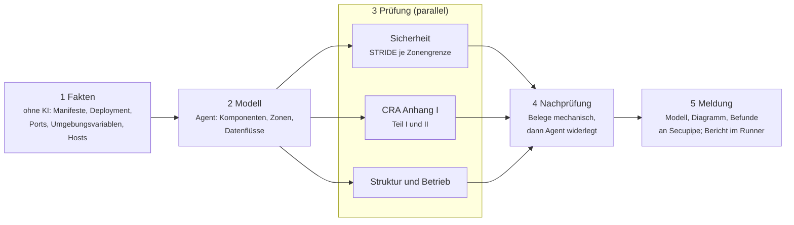

# Secupipe Autofix

Container-Job für die CI/CD-Pipeline: holt offene Fix-Aufträge aus [Secupipe](https://secupipe.com) ab, hebt die
betroffenen Pakete auf die gefixte Version, lässt Build und Tests laufen und öffnet je Paket einen Pull Request
(GitHub) bzw. Merge Request (GitLab). Schlägt das fehl, passt optional ein KI-Agent (Claude Code) den Code an.

**Alles läuft auf deinem Runner.** Secupipe bekommt keinen Quellcode, nur Status, PR-Link und das Ende des
Protokolls. Den Schlüssel für den KI-Agenten hinterlegst du selbst. Gemergt wird nie automatisch.

## Modus (Einstellungen in Secupipe)

| Modus | Was passiert |
|---|---|
| Nur Versions-Update | Update, Build und Tests; bei Fehlern PR-Entwurf mit Protokoll. Ohne KI. |
| Update, KI bei Fehlern (Standard) | Wie oben; bricht das Update etwas, passt der KI-Agent den Code an. |
| KI-Agent zuerst | Der Agent prüft jeden Auftrag: Nutzung des Pakets, Erreichbarkeit der Lücke, Code-Anpassung, Zusammenfassung im PR. Ist das Update nicht sinnvoll machbar und die Lücke nicht erreichbar, meldet er »nicht betroffen« als VEX-Vorschlag; gültig erst nach Freigabe in Secupipe. |

Die KI-Stufen brauchen das Modul KI und einen eigenen Schlüssel in der Pipeline.

## Ablauf

1. In Secupipe beim Befund **Fix-PR erstellen** klicken, oder `AUTO=hoch` setzen: dann legt der Job selbst
   Aufträge für alle offenen Befunde ab diesem Schweregrad an.
2. Der Job (z. B. stündlich) holt die Aufträge für sein Repository (`REPO`, wie `pipeline=…` beim SBOM-Upload).
3. Je Paket: Branch `secupipe/fix-<paket>-<version>`, Update, Build und Tests.
   - grün → Pull Request
   - rot und Modul KI gebucht und Schlüssel vorhanden → KI-Agent passt den Code an, dann erneut Build und Tests
   - weiter rot → Pull Request als Entwurf mit Protokoll
4. Status und PR-Link erscheinen in Secupipe beim Befund. Nach dem nächsten SBOM-Upload gilt der Befund als behoben.

Automatisch unterstützt: npm (direkt und transitiv über `overrides`, veraltete Versionen werden übersprungen),
Go-Module, feste Versionen in `requirements*.txt`. Andere Ökosysteme über den KI-Agenten.

## GitHub Actions

```yaml
# .github/workflows/secupipe-autofix.yml
name: Secupipe Autofix
on:
  schedule:
    - cron: '17 * * * *'
  workflow_dispatch:
permissions:
  contents: write
  pull-requests: write
jobs:
  autofix:
    runs-on: ubuntu-latest
    container: ghcr.io/costa-chown/secupipe-autofix:1
    steps:
      - uses: actions/checkout@v5
      - run: secupipe-autofix
        env:
          SECUPIPE_TOKEN: ${{ secrets.SECUPIPE_TOKEN }}
          GITHUB_TOKEN: ${{ github.token }}
          REPO: ${{ github.repository }}
          AUTO: hoch
          ANTHROPIC_API_KEY: ${{ secrets.ANTHROPIC_API_KEY }}
```

In den Repository-Einstellungen unter *Actions → General* „Allow GitHub Actions to create and approve pull requests“
einschalten. PRs mit `github.token` starten keine weiteren Workflows; für CI auf dem PR ein Token einer GitHub App
übergeben.

## GitLab CI

```yaml
secupipe-autofix:
  image:
    name: ghcr.io/costa-chown/secupipe-autofix:1
    entrypoint: [""]
  rules:
    - if: $CI_PIPELINE_SOURCE == "schedule" || $CI_PIPELINE_SOURCE == "web"
  variables:
    GIT_DEPTH: "0"
    REPO: $CI_PROJECT_PATH
    AUTO: hoch
  script:
    - secupipe-autofix
```

Variablen: `SECUPIPE_TOKEN`, `GITLAB_TOKEN` (Projekt-Token mit `api` und `write_repository`), optional `ANTHROPIC_API_KEY`.

## Andere CI-Systeme

```bash
docker run --rm -v "$PWD:/repo" -w /repo \
  -e SECUPIPE_TOKEN -e GITHUB_TOKEN -e ANTHROPIC_API_KEY -e PLATTFORM=github \
  -e REPO=acme/shop -e BASE_BRANCH=main \
  ghcr.io/costa-chown/secupipe-autofix:1
```

## Code-Scan: eigenen Code mit KI prüfen

Das Image enthält einen zweiten Befehl, `secupipe-codescan`. Ein KI-Agent (Claude Code) prüft den eigenen Quellcode
im ausgecheckten Repository auf Schwachstellen, etwa Injection, fehlende Rechteprüfung, Zugriff auf Daten anderer
Mandanten oder fest eingetragene Geheimnisse. Die Befunde erscheinen in Secupipe unter Schwachstellen, neben den
Befunden aus dem SBOM-Abgleich: mit Frist, VEX-Bewertung, Alarm und Jira. Der Code-Scan braucht das Modul KI.

**Secupipe bekommt keinen Quellcode.** Gemeldet werden je Befund nur CWE, Datei, Zeile, Funktion, Beschreibung und
Empfehlung. Der Agent darf nur lesen: Er ändert keine Dateien, führt keinen Code des Repositorys aus und hat über
seine Werkzeuge keinen Netzzugriff. Der Quellcode geht an den KI-Anbieter, dessen Schlüssel du hinterlegst
(Anthropic, oder Bedrock/Vertex in einer EU-Region).

So läuft ein Scan ab:

1. Der Job holt die bekannten Code-Befunde des Repositorys bei Secupipe ab.
2. **Suche:** Der Agent prüft den Code nach Risiko (Eingänge aus dem Netz, Anmeldung, Datenbank, Dateien, Kryptografie)
   und prüft jeden bekannten Befund erneut: noch vorhanden oder behoben.
3. **Nachprüfung:** Ein zweiter Durchgang versucht, jeden neuen Befund zu widerlegen, und streicht Fehlalarme.
4. Befunde ab 60 % Konfidenz gehen an Secupipe. Neue Befunde beginnen »in Prüfung«.

Dieselbe Stelle wird nicht doppelt angelegt: Secupipe erkennt sie an CWE, Datei und Funktion, auch wenn der Agent sie
anders formuliert oder die Zeile sich verschiebt. Einen als »nicht betroffen« bewerteten Befund (Fehlalarm) meldet der
Agent nicht erneut. Hält der Agent einen Befund für behoben, wird das in Secupipe ein Vorschlag am Befund; gültig ist
er erst, wenn ein Mensch ihn freigibt. Ein Befund gilt nicht als behoben, nur weil ein Lauf ihn nicht mehr nennt.

```yaml
# .github/workflows/secupipe-codescan.yml
name: Secupipe Code-Scan
on:
  pull_request:              # nur geänderte Dateien
  schedule:
    - cron: '23 3 * * 1'     # montags das ganze Repository
  workflow_dispatch:
permissions:
  contents: read
jobs:
  codescan:
    runs-on: ubuntu-latest
    container: ghcr.io/costa-chown/secupipe-autofix:1
    steps:
      - uses: actions/checkout@v5
        with:
          fetch-depth: 0
      - run: secupipe-codescan
        env:
          SECUPIPE_TOKEN: ${{ secrets.SECUPIPE_TOKEN }}
          ANTHROPIC_API_KEY: ${{ secrets.ANTHROPIC_API_KEY }}
          REPO: ${{ github.repository }}
          FAIL_ON: hoch
```

In GitHub Actions erscheinen neue Befunde zusätzlich als Hinweis an der Zeile im Pull Request.

GitLab CI: derselbe Job wie beim Autofix, mit `script: [secupipe-codescan]` und den Regeln
`$CI_PIPELINE_SOURCE == "merge_request_event"` (geänderte Dateien) und `"schedule"` (ganzes Repository).
Andere CI-Systeme und lokal:

```bash
docker run --rm -v "$PWD:/repo" -w /repo --entrypoint secupipe-codescan \
  -e SECUPIPE_TOKEN -e ANTHROPIC_API_KEY -e REPO=acme/shop \
  ghcr.io/costa-chown/secupipe-autofix:1
```

| Variable | Bedeutung |
|---|---|
| `SECUPIPE_TOKEN`, `REPO` | wie beim Autofix |
| `ANTHROPIC_API_KEY` | Schlüssel für den Agenten (alternativ `CLAUDE_CODE_USE_BEDROCK` / `CLAUDE_CODE_USE_VERTEX`) |
| `UMFANG` | `voll` = ganzes Repository, `diff` = nur geänderte Dateien. Standard: `diff` in Pull/Merge Requests, sonst `voll` |
| `DIFF_BASE` | Vergleichsstand für `diff`, Standard der Zielbranch des Pull/Merge Requests |
| `PFADE` | nur diese Verzeichnisse prüfen, z. B. `"src api"` |
| `FAIL_ON` | Lauf schlägt fehl, wenn offene Code-Befunde ab diesem Schweregrad vorliegen |
| `MIN_KONFIDENZ` | Befunde unter diesem Wert nicht melden, Standard `0.6` |
| `PRUEFEN=0` | Nachprüfung auslassen (halbe Kosten, mehr Fehlalarme) |
| `DRY_RUN=1` | nichts an Secupipe melden, Ergebnis nur ausgeben |
| `KI_MODEL`, `KI_MAX_TURNS` (120), `KI_BUDGET_USD` (10) | Grenzen je Durchgang |

## Architektur-Review: Architektur beschreiben und prüfen

Der dritte Befehl im Image, `secupipe-archreview`, lässt KI-Agenten die Architektur des Repositorys beschreiben und
prüfen. Ergebnis ist ein **Architekturmodell mit Diagramm** (Komponenten, Vertrauenszonen, Datenflüsse) und eine Liste
von **Befunden mit Belegen** (Datei und Zeile). Secupipe zeigt beides unter »Architektur«; das Diagramm und die
Beschreibung lassen sich als Teil der technischen Dokumentation nach CRA Anhang VII herunterladen. Braucht das Modul KI.



1. **Fakten** sammelt der Job ohne KI: Sprachen, Paket-Manifeste, Dockerfiles, Compose, Kubernetes, Terraform,
   CI-Dateien, freigegebene Ports, Namen der Umgebungsvariablen (keine Werte) und Hosts, die der Code anspricht.
2. **Modell:** Ein Agent beschreibt Komponenten (höchstens 30), ordnet sie fünf Zonen zu (Nutzer, Rand, Anwendung,
   Daten, Dienste Dritter) und erfasst die Datenflüsse mit Protokoll, Daten, Anmeldung und Verschlüsselung.
   In Pull Requests aktualisiert er nur das Modell des letzten Laufs.
3. **Prüfung:** Drei Agenten parallel. *Sicherheit* erstellt ein Bedrohungsmodell nach STRIDE für jeden Fluss über
   eine Zonengrenze. *CRA* prüft die grundlegenden Anforderungen aus Anhang I Teil I und II, soweit sie am Repository
   erkennbar sind (sichere Voreinstellungen, Zugriffsschutz, Verschlüsselung, Protokollierung, SBOM, Meldekanal,
   sichere Updates). *Struktur* prüft Schichten, Kopplung, Ausfallpunkte, Zeitlimits und Konfiguration.
4. **Nachprüfung:** Belege müssen auf vorhandene Dateien und Zeilen zeigen; Befunde mit erfundenen Belegen fallen
   weg. Dann versucht ein weiterer Agent, jeden Befund zu widerlegen.
5. **Meldung:** Modell, Diagramm (Mermaid) und Befunde ab 60 % Konfidenz gehen an Secupipe. Im Runner liegen
   `architektur.md` (Bericht mit Diagramm), `architektur.mmd` und `architektur.json`; in GitHub Actions steht der
   Bericht zusätzlich in der Zusammenfassung des Laufs.

Jeder Befund hat einen festen Schlüssel; Secupipe zeigt, was seit dem letzten Lauf neu ist und was entfallen ist.
Befunde, die ihr bewusst hinnehmt, markiert ihr in Secupipe als »hingenommen« mit Begründung; die Agenten melden sie
dann nicht mehr. Wie beim Code-Scan bekommt Secupipe keinen Quellcode, nur Modell und Befundtexte.

```yaml
# .github/workflows/secupipe-architektur.yml
name: Secupipe Architektur-Review
on:
  pull_request:              # nur Änderungen gegenüber dem Zielbranch
  schedule:
    - cron: '41 3 1 * *'     # monatlich das ganze Repository
  workflow_dispatch:
permissions:
  contents: read
jobs:
  architektur:
    runs-on: ubuntu-latest
    container: ghcr.io/costa-chown/secupipe-autofix:1
    steps:
      - uses: actions/checkout@v5
        with:
          fetch-depth: 0
      - run: secupipe-archreview
        env:
          SECUPIPE_TOKEN: ${{ secrets.SECUPIPE_TOKEN }}
          ANTHROPIC_API_KEY: ${{ secrets.ANTHROPIC_API_KEY }}
          REPO: ${{ github.repository }}
      - uses: actions/upload-artifact@v6
        if: always()
        with:
          name: architektur
          path: secupipe-architektur/
```

| Variable | Bedeutung |
|---|---|
| `SECUPIPE_TOKEN`, `REPO`, `ANTHROPIC_API_KEY`, `UMFANG`, `DIFF_BASE`, `PFADE`, `FAIL_ON`, `MIN_KONFIDENZ`, `DRY_RUN` | wie beim Code-Scan |
| `BEREICHE` | Standard `"sicherheit cra struktur"` |
| `AUSGABE` | Verzeichnis für den Bericht, Standard `secupipe-architektur` |
| `PARALLEL=0` | Prüf-Agenten nacheinander starten |
| `PRUEFEN=0` | Nachprüfung auslassen |
| `KI_MODEL`, `KI_MAX_TURNS` (150), `KI_BUDGET_USD` (8) | Grenzen je Agent; ein voller Lauf startet bis zu fünf Agenten |

### Architektur-Befunde mit KI beheben (`secupipe-archfix`)

Zu jedem Architektur-Befund lässt sich in Secupipe ein **KI-Fix** anfordern, oder die Pipeline legt Aufträge
automatisch an (`AUTO=hoch`). `secupipe-archfix` holt die Aufträge ab (die schwersten zuerst, höchstens `MAX_FIXES`
je Lauf). Für jeden Befund setzt ein KI-Agent die Empfehlung im Repository um, prüft Build und Tests und öffnet einen
Pull Request. Gemergt wird nie automatisch.

- Trifft der Befund nicht mehr zu, meldet der Agent das ohne PR.
- Lässt er sich nicht im Repository beheben (Datensicherung auf dem Server, Einstellung in einem Cloud-Konto), meldet
  der Agent »nicht möglich« mit einer Anleitung für den manuellen Schritt. Die Automatik legt dafür keinen neuen
  Auftrag an.
- Sind Build oder Tests nach der Änderung rot, gibt es keinen PR; der Auftrag ist »fehlgeschlagen« und lässt sich
  erneut anfordern.
- Änderungen an `.github/workflows` und neue Dateien über 1 MB übernimmt das Skript nicht.

```yaml
# .github/workflows/secupipe-architektur-fix.yml
name: Secupipe Architektur-Fix
on:
  schedule:
    - cron: '17 6-18/3 * * 1-5'   # werktags alle drei Stunden: angeforderte Fixes abholen
  workflow_dispatch:
permissions:
  contents: write
  pull-requests: write
jobs:
  archfix:
    runs-on: ubuntu-latest
    container: ghcr.io/costa-chown/secupipe-autofix:1
    steps:
      - uses: actions/checkout@v5
      - run: secupipe-archfix
        env:
          SECUPIPE_TOKEN: ${{ secrets.SECUPIPE_TOKEN }}
          ANTHROPIC_API_KEY: ${{ secrets.ANTHROPIC_API_KEY }}
          GITHUB_TOKEN: ${{ github.token }}
          REPO: ${{ github.repository }}
          # AUTO: hoch              # optional: alle offenen Befunde ab hoch automatisch
```

| Variable | Bedeutung |
|---|---|
| `AUTO` | Aufträge für alle offenen, nicht hingenommenen Befunde ab diesem Schweregrad anlegen |
| `MAX_FIXES` | höchstens so viele Befunde je Lauf, Standard `3` |
| `CHECK_CMD` | eigener Prüfbefehl; sonst Go: build, vet, test; npm: build (`NPM_TEST=1` auch test) |
| `KI_MODEL`, `KI_MAX_TURNS` (80), `KI_BUDGET_USD` (5) | Grenzen je Befund |

### Gesamtarchitektur und Verbesserungsvorschläge

Nach jedem Review fasst ein weiterer Agent die Modelle aller Repositorys des Projekts zusammen, die in Secupipe
gespeichert sind (z. B. `shop-api`, `shop-web`, `shop-site`): dieselbe Komponente aus Sicht mehrerer Repositorys wird
ein Knoten, Datenflüsse zwischen den Repositorys kommen dazu. Daraus macht er 5 bis 15 **Verbesserungsvorschläge für
die Architektur als Ganzes**, je mit Nutzen, Aufwand (Tage, Wochen, Monate), Priorität, betroffenen Komponenten und
den Befunden, die der Vorschlag zusammenfasst. Er arbeitet nur mit Modellen und Befunden, nicht mit Quellcode; Kosten
höchstens `KI_BUDGET_GESAMT_USD` (Standard 3). `GESAMT=0` schaltet den Schritt ab, `NUR_GESAMT=1` erstellt nur die
Gesamtarchitektur neu, ohne das Repository erneut zu prüfen.

### Projekte und SBOMs

Secupipe gliedert die Architektur nach Projekten. Ohne Angabe gilt der Repository-Name ohne Endung wie `-api`,
`-web` oder `-site` als Projekt (`acme/shop-api` und `acme/shop-web` → `shop`); mit `PROJEKT=…` legt ihr es selbst
fest. Das Review ordnet jeder Komponente die SBOM zu, die die Pipeline des Repositorys hochlädt; in Secupipe führt
ein Klick auf die Komponente zur SBOM mit allen Paketen und Schwachstellen.

## Umgebung (Autofix)

| Variable | Bedeutung |
|---|---|
| `SECUPIPE_TOKEN` | Pipeline-Token aus Secupipe (Pflicht) |
| `REPO` | Repository wie beim SBOM-Upload (`pipeline=…`) |
| `AUTO` | Aufträge ab Schweregrad anlegen: `kritisch`, `hoch`, `mittel`, `niedrig` |
| `CHECK_CMD` | eigener Prüfbefehl statt Build/Tests je Ökosystem |
| `BASE_BRANCH` | Zielbranch, Standard der ausgecheckte Branch |
| `DRY_RUN=1` | nichts pushen, keinen PR öffnen |
| `ANTHROPIC_API_KEY` | KI-Agent (alternativ `CLAUDE_CODE_USE_BEDROCK` / `CLAUDE_CODE_USE_VERTEX` mit EU-Region) |
| `KI_MODEL`, `KI_MAX_TURNS` (40), `KI_BUDGET_USD` (5) | Grenzen für den KI-Agenten |

Der KI-Agent darf nur Dateien lesen und ändern sowie Build-Werkzeuge (npm, go, pip, mvn, gradle) ausführen;
committen und pushen übernimmt das Skript.
